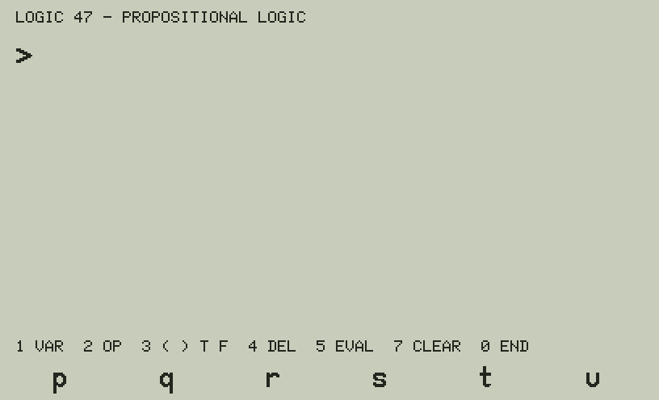

# Logic 47 — propositional logic for the C47 / R47

`LOGIC47` tells whether a formula of propositional logic is a **tautology**, a **contradiction** or a
**contingency**, on the SwissMicros C47 / R47. It counts the rows where the formula is true and, for a
contingency, gives a row where it is true and one where it is false.

## The formula

- Variables **p q r s t u** (up to six), constants **⊤** (true, shown as a plain `T`: the font's ⊤ is a small raised T) and **⊥** (false).
- Connectives **¬** (not), **∧** (and), **∨** (or), **⊕** (exclusive or), **→** (implies), **↔** (if and
  only if), and brackets.
- Precedence, from the highest: ¬, ∧, ∨ and ⊕, →, ↔. So `p∨q∧r` is `p∨(q∧r)` and `¬p∧q` is `(¬p)∧q`.
  → groups to the right (`p→q→r` = `p→(q→r)`); ∧ ∨ ⊕ ↔ to the left.
- Typed with the soft keys, symbol by symbol, shown with the real glyphs of the C47 font.

## Keys

| Key | |
|---|---|
| F1–F6 | a symbol of the page shown under the screen |
| 1 | page 1: `p q r s t u` |
| 2 | page 2: `¬ ∧ ∨ → ↔ ⊕` |
| 3 | page 3: `( ) T ⊥` |
| 4 | delete the last symbol |
| 5 | evaluate |
| 7 | clear the formula |
| 0 | the end: the screen cleared, your stack and LASTx as they were |

## The answer

    TAUTOLOGY            true in 8 of 8 rows
    CONTRADICTION        true in 0 of 2 rows
    CONTINGENCY          true in 3 of 8 rows
                         T: p=1 q=0 r=0   F: p=0 q=0 r=0
    SYNTAX ERROR         (a missing operand or bracket, two operands side by side...)

The rows are those of the variables in the formula: 2ⁿ for n variables.

## How: the whole truth table at once

The C47 has 64-bit integers and bitwise `AND`, `OR`, `XOR`, `NOT`. Each variable is a 64-bit word whose bit k
is its value in row k:

    p = …10101010   q = …11001100   r = …11110000   s = …1111111100000000   …   u = 32 ones, 32 zeros

The formula is evaluated **once** on these words (shunting-yard: values and operators on two stacks of
registers), with `→` as `¬a ∨ b` and `↔` as `¬(a ⊕ b)`. The result word *is* the truth table: all ones a
tautology, all zeros a contradiction. `BS?` / `BC?` on each of its 64 bits count the true rows and find the
example rows. A variable not in the formula only repeats rows, so the count is divided by 2^(6 − n).

A formula of 20 symbols is evaluated in about 2 500 steps in the simulator (about 0.4 s on a C47 at Almanac
47's measured 0.17 ms a step), the same for 1 or 6 variables.

## Build, simulator and tests

| | |
|---|---|
| `programs_rem/LOGIC47.txt` | the commented source (STRUCT, named labels) — edit this one |
| `programs/LOGIC47.txt`, `build/LOGIC47.txt` | the calculator program (to convert with rejig) |
| `listings/` | numbered steps with comments, the local labels |
| `python/c47sim.py`, `stdfont.py`, `tinyfont.py` | the C47 simulator and fonts, from Almanac 47; the bitwise commands added here |
| `python/logic47sim.py` | runs LOGIC47 in the simulator, writes `docs/*.png` |
| `tests/test_logic47.py` | the tests |

    python3 tools/build_logic47.py
    python3 tests/test_logic47.py    # 39 fixed cases (classics, precedence, syntax errors), 300+ random formulas,
                                     # each against a separate Python evaluator; delete, clear, the stack
    python3 python/logic47sim.py     # docs/LOGIC47_*.png
    python3 tools/make_gif.py        # docs/LOGIC47_demo.gif

Size: 779 steps, about 2.9 KB; no IF, 10 DO (the original DM42's limit). Written with the C47 STRUCT commands.
Calculators: C47 / R47 with STRUCT, ATEXT and GRFNT (firmware 00.109.05.00a0.ALPHA or later, as Elements 47).
**Not yet run on a real C47**: the bitwise commands (`AND OR XOR NOT BS? BC?`) are new to these projects and
need a first try.

## Credits and licence

Victor Valdes, GNU GPL v3.0 or later (`LICENSE`, the same as Almanac 47; `NOTICE`). Written with the help of
AI, used responsibly: see `AI_ASSISTANCE.md`. Fonts: the C43/C47 firmware. SwissMicros, C47, R47 and DM42 are
trademarks of their owners.
